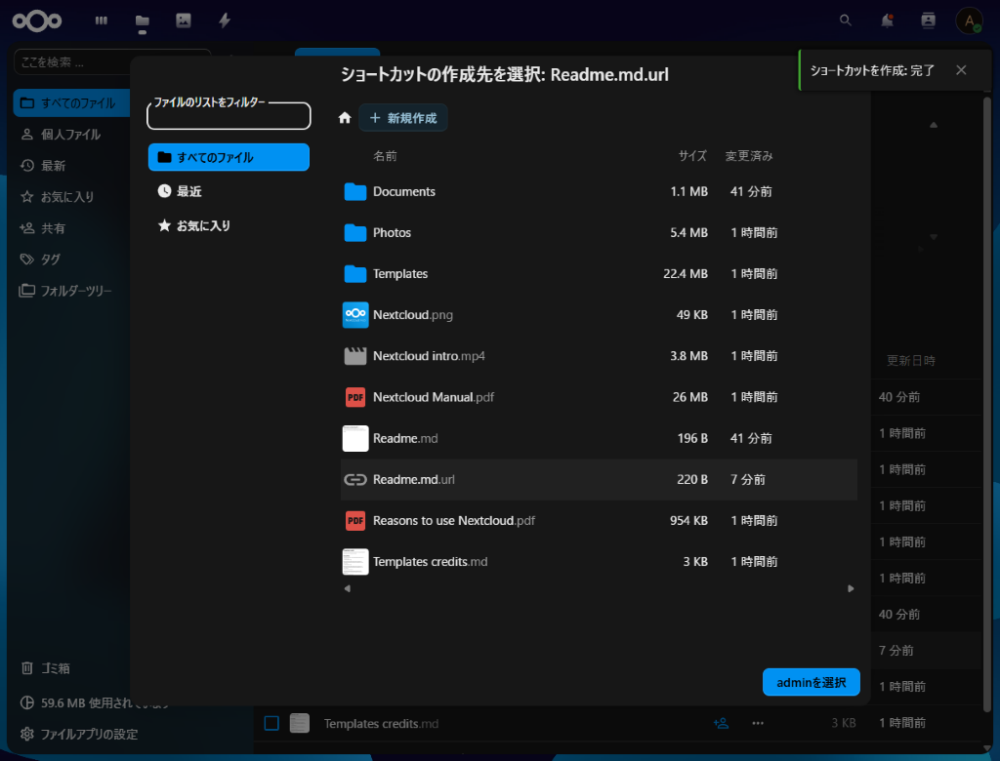
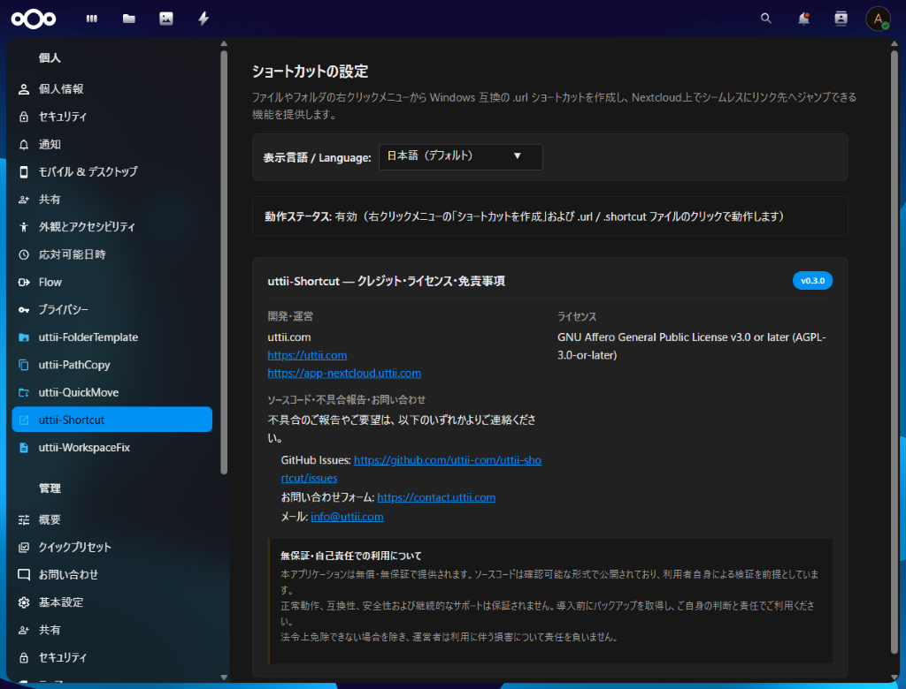

# uttii-Shortcut for Nextcloud (`shortcut`)

Create and inline-open Windows-compatible .url shortcuts to folders and files in Nextcloud Files.  
Nextcloud Files 上でフォルダやファイルのショートカット（.url 形式）を作成・インライン展開できるアプリ。

---

## Screenshots / スクリーンショット

| Files UI / ファイル画面 | Personal Settings / 個人設定 |
|---|---|
|  |  |

---

## Features (English)

- **Inline Fast Navigation (Nextcloud Web UI)**: Clicking a `.url` shortcut inside Nextcloud Files resolves its `fileId` and navigates inline without full page reloads.
- **Move & Rename Resilient**: Tracks targets by `fileId` so shortcuts keep working even when targets are renamed or moved.
- **Windows `.url` Compatible (Desktop Sync)**: Uses standard INI `.url` format with `[NextcloudShortcut]` metadata; opening the synced `.url` file on Windows launches the Nextcloud target URL in your default browser.
- **Batch Creation & Cleanup**: Create shortcuts for multiple items at once and detect/clean up broken shortcuts.
- **Language Switch**: Switch between Japanese (default) and English in Personal Settings.

## 主な機能・特徴 (日本語)

- **インライン高速展開（Nextcloud Web UI）**: Nextcloud Files 上で `.url` ショートカットをクリックすると `fileId` を解決し、画面再読み込みや別タブ遷移なしでフォルダへ移動・ファイルを開きます。
- **移動・リネーム耐性**: `fileId` ベースで参照先を追跡するため、対象の名前変更や移動後もリンク切れを防ぎます。
- **Windows `.url` 互換（同期フォルダ上での利用）**: 標準の `.url`（INI）形式にメタデータを付与しているため、Windows 同期フォルダ上で開いた場合は記載された Nextcloud URL が既定のブラウザで開きます。
- **一括作成・クリーンアップ**: 複数アイテムの同時ショートカット作成や、参照先が削除された無効リンクの一括整理に対応します。
- **言語切替**: 個人設定画面から日本語（デフォルト）／英語を切り替えられます。

---

## Requirements / 動作要件

- **Nextcloud Server**: 28 – 35
- **PHP**: 8.0 or higher (8.2 / 8.3 recommended)
- **Dependencies**: Nextcloud core APIs only (no custom database tables or external libraries required)

---

## Installation / インストール方法

### From Nextcloud App Store (Coming Soon / 公開準備中)
Currently preparing for Nextcloud App Store submission. Once published, you will be able to search for **uttii-Shortcut** in Nextcloud **Apps** and click **Download and enable**.  
現在 Nextcloud App Store への登録準備中です。公開後は Nextcloud の「アプリ」画面から **uttii-Shortcut** を検索して有効化できるようになります。

### From Release Archive (`.tar.gz`)
1. Download `shortcut-v0.3.0.tar.gz` from [app-nextcloud.uttii.com](https://app-nextcloud.uttii.com/) *(GitHub Releases is also being prepared)*.
2. Extract it into your Nextcloud `apps` (or `custom_apps`) directory:
   ```bash
   cd /var/www/nextcloud/apps
   sudo tar -xzf /path/to/shortcut-v0.3.0.tar.gz
   sudo chown -R www-data:www-data shortcut
   ```
3. Enable the app:
   ```bash
   sudo -u www-data php /var/www/nextcloud/occ app:enable shortcut
   ```

---

## Configuration / 設定・言語切り替え

Open **Personal settings → uttii-Shortcut** to:
- Switch display language between **Japanese (default)** and **English**
- Manage app-specific settings and view license/credit information

個人設定画面の **「uttii-Shortcut」** から、表示言語の切り替え（日本語デフォルト／英語）や各種設定を行えます。

---

## Uninstallation / アンインストール方法

```bash
sudo -u www-data php /var/www/nextcloud/occ app:disable shortcut
sudo rm -rf /var/www/nextcloud/apps/shortcut
```

---

## Bug Reports & Contact / 不具合報告・お問い合わせ

Please report bugs or feature requests via any of the following:
- **GitHub Issues**: [https://github.com/uttii-com/uttii-shortcut/issues](https://github.com/uttii-com/uttii-shortcut/issues)
- **Contact Form**: [https://contact.uttii.com](https://contact.uttii.com)
- **Email**: [info@uttii.com](mailto:info@uttii.com)

---

## License & Disclaimer / ライセンス・免責事項

- **License**: GNU Affero General Public License v3.0 or later (`AGPL-3.0-or-later`) — see [LICENSE](./LICENSE).
- **Copyright**: (C) 2026 [uttii.com](https://uttii.com)

### Disclaimer (No Warranty & Self-Responsibility)
This application is provided free of charge on an "AS IS" basis without warranty of any kind. Its source code is publicly available for user verification. Normal operation, compatibility, security, and continuous support are not guaranteed. Please take backups before installation and use at your own discretion and risk. Except where liability cannot be excluded by law, the operator shall not be liable for any damages arising from its use.

### 無保証・自己責任での利用について
本アプリケーションは無償・無保証で提供されます。ソースコードは確認可能な形式で公開されており、利用者自身による検証を前提としています。
正常動作、互換性、安全性および継続的なサポートは保証されません。導入前にバックアップを取得し、ご自身の判断と責任でご利用ください。
法令上免除できない場合を除き、運営者は利用に伴う損害について責任を負いません。
